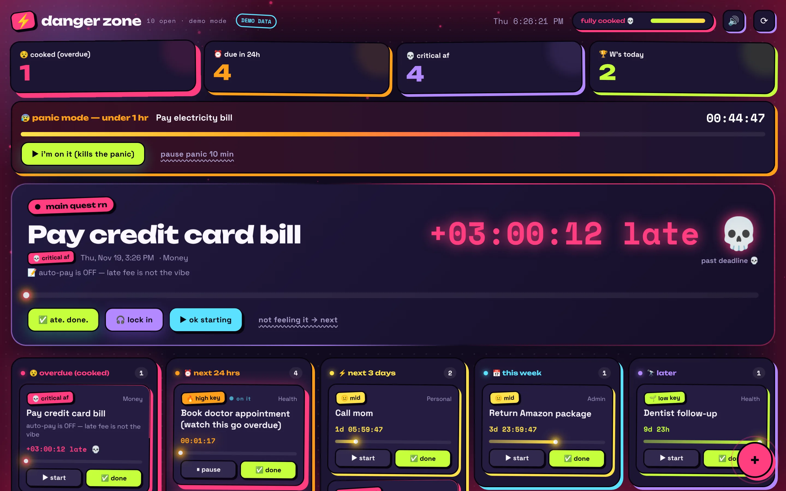
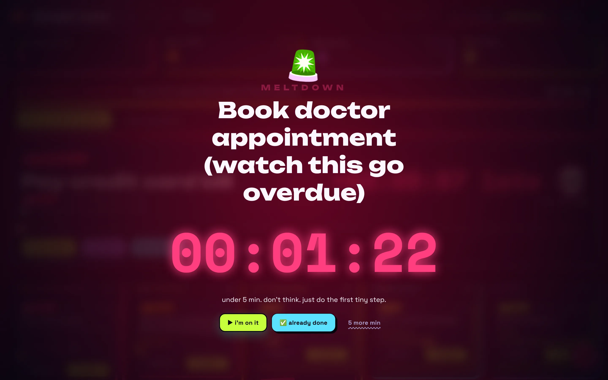
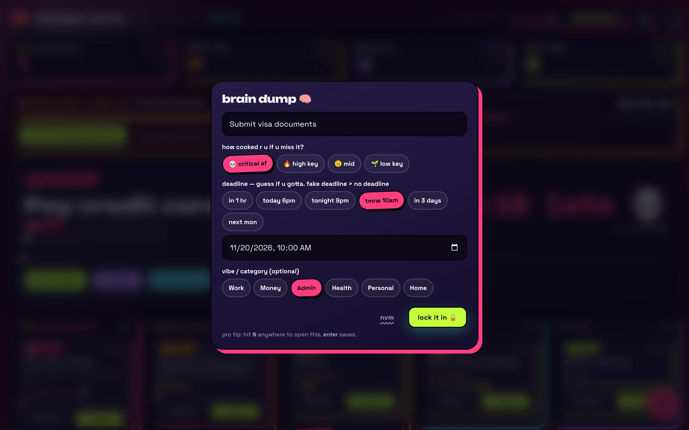
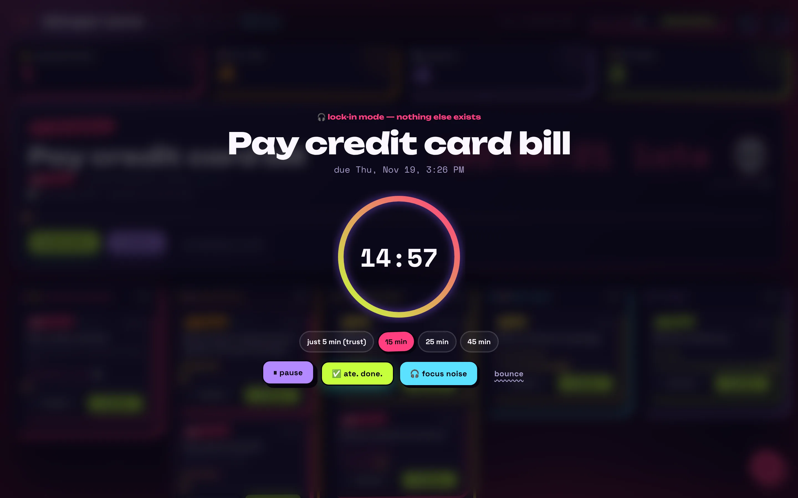
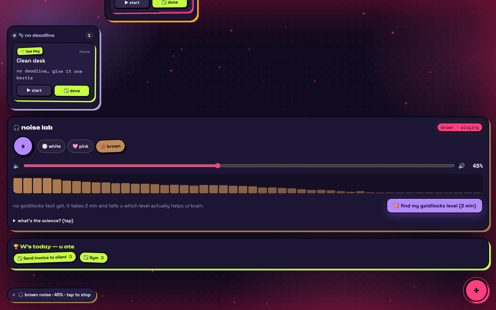
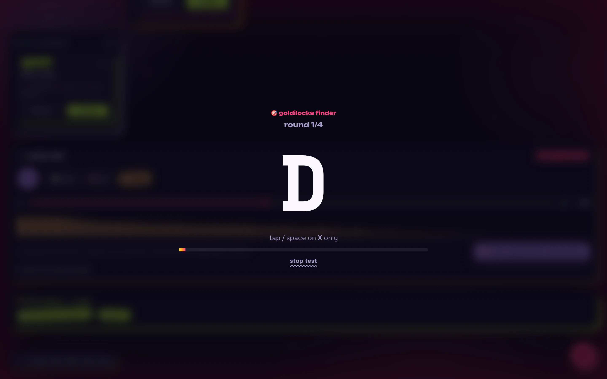
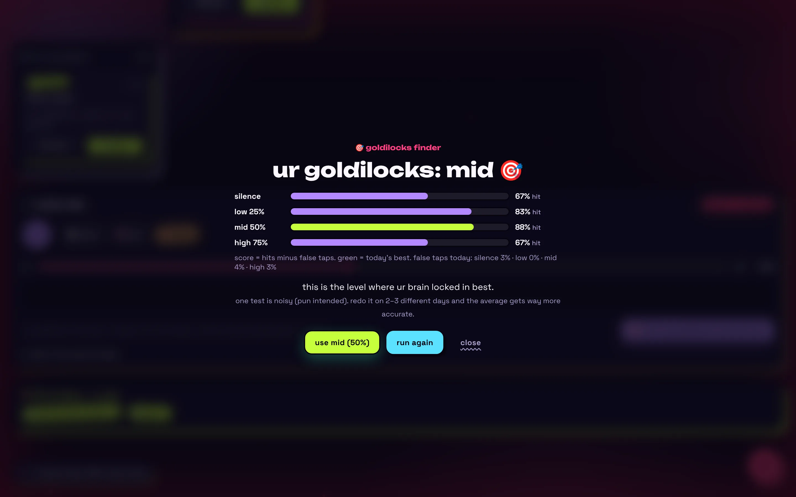
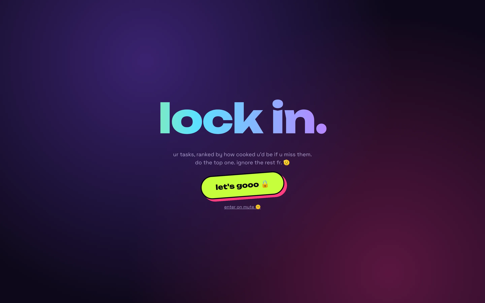
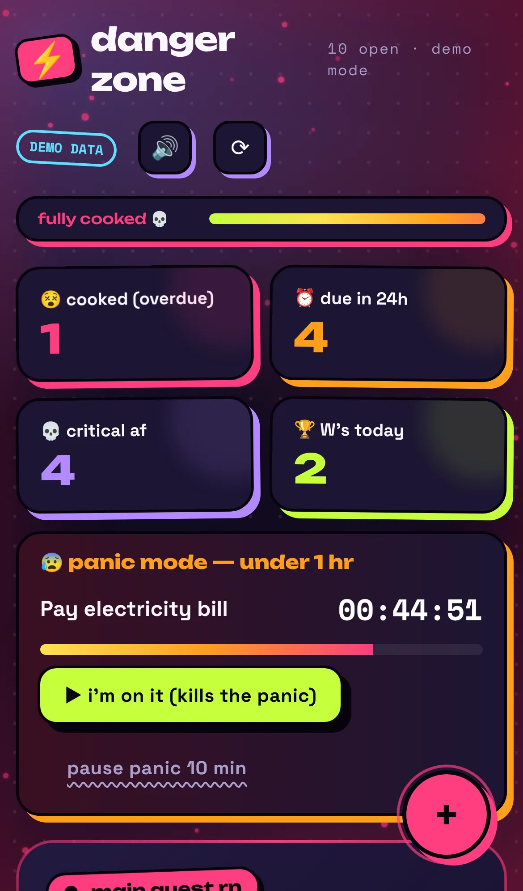
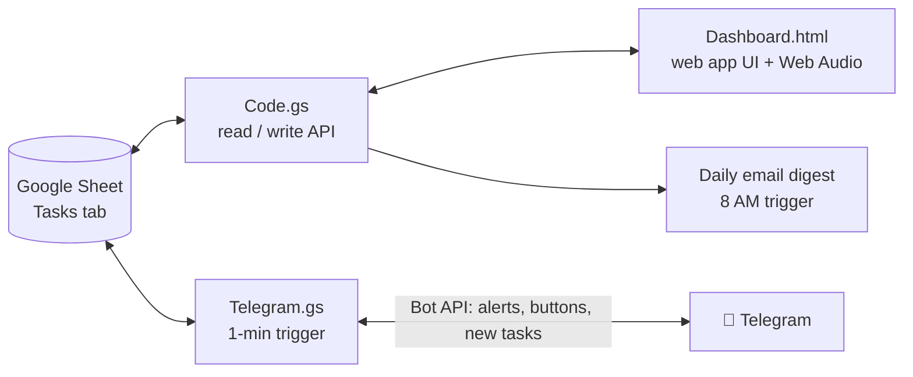

# ⚡ Danger Zone

**A deadline dashboard that makes urgency visible and audible, built on Google Sheets with 24x7 Telegram alerts.**

Tasks live in a Google Sheet. An animated dashboard (Google Apps Script web app) ranks them by danger and deadline, shows one task to do now, and escalates as deadlines approach with countdowns, a heartbeat that speeds up, and screen effects. A background trigger sends Telegram alerts around the clock, even when the dashboard is closed.

The design follows research on ADHD and executive function: make time visible, cut decisions down to one, reward finishing, and never punish pausing.




---

## Features

**Prioritisation**
- **Main quest:** one task picked by `danger × closeness of deadline` (overdue always wins), so there's no "where do I start" decision.
- **Lanes:** overdue · next 24 hrs · next 3 days · this week · later · no deadline.
- **Live countdowns** with a burning fuse bar for every task.

**Urgency that ramps up (panic mode)**
| Time left | Level | Effects |
|---|---|---|
| ≤ 3 hrs | tense | slow heartbeat, red edges pulse on each beat |
| ≤ 1 hr | panic | faster heartbeat, ticking clock, glitching countdown |
| ≤ 10 min | meltdown | racing heartbeat, rising drone, screen glitch, full-screen alert at 5 min |
| missed | blown | irregular heartbeat, then periodic reminders |

Starting a task (**▶ i'm on it**) switches its panic off immediately, so the only way out of the pressure is to begin.

**24x7 Telegram alerts** (server-side, every minute)
- Pings at 3 hrs → 1 hr → 10 min (×2) → 5 min (×3) → deadline (×4), then every 30 min while overdue.
- Inline buttons on every alert: **▶ on it · ✅ done · 😴 snooze**.
- Send the bot any message to add a task; tap buttons to set its deadline and danger level.
- Quiet hours (11 PM–7 AM) let only imminent deadlines through.

**Sound design** (all synthesised live with the Web Audio API, no audio files)
- A different reward melody each time, combo streaks that climb in pitch, occasional jackpots.
- An escalation ladder that is noticeable but never harsh; no "fail" sounds anywhere.
- Full / soft (sensory-friendly) / off modes; Android vibration.
- [7 exported MP3s](sounds/) for use as phone or Telegram notification sounds.

**Noise lab**
- White, pink and brown noise **generated live, so it never loops**, with filtered rumble and hiss and matched loudness ([measurements](docs/noise-measurements.md)).
- **Goldilocks finder:** a 2-minute attention test across four noise levels that finds the level where *you* focus best, averaged across runs.

**Also:** quick-add (`N`), focus mode with sprint timer (`F`), a daily 8 AM email digest, and a Google Sheet template with colour coding and auto-computed urgency.

## Screenshots

| | |
|---|---|
|  **Meltdown alert** at 5 minutes |  **Quick add** with one-tap deadlines |
|  **Focus mode** with sprint timer |  **Noise lab** with live visualiser |
|  **Goldilocks finder** test round |  **Finder result** |
|  **Welcome screen** (unlocks audio) |  **Mobile** |

## How it works



| Layer | Tech |
|---|---|
| Data | Google Sheets (formulas compute hours left + urgency; conditional formatting) |
| Backend | Google Apps Script (V8): `google.script.run` API, time-driven triggers, `UrlFetchApp`, `MailApp`, `PropertiesService`, `LockService` |
| Frontend | Vanilla HTML/CSS/JS in one file, Canvas particle effects, Web Audio API (FM bells, compressor, convolution reverb), `AudioWorklet` noise generator |
| Alerts | Telegram Bot API via `getUpdates` polling (no public webhook needed) |
| Tooling | Node test harness with mocked Apps Script services; Python + Playwright + SciPy + ffmpeg audio analysis |

More detail and the research behind each decision: **[docs/design-and-research.md](docs/design-and-research.md)**.

## Quick start

1. Import [`template/Danger_Zone_Tasks.xlsx`](template/) into Google Sheets and set the sheet's time zone.
2. Open **Extensions → Apps Script** and add `Code.gs`, `Telegram.gs` and `Dashboard.html` from [`apps-script/`](apps-script/).
3. Run `setupSheet` once and approve the permissions.
4. Open the dashboard from the **⚡ Danger Zone** menu, or deploy it as a web app for your phone.
5. *(Optional)* Create a bot with @BotFather and choose **⚡ Danger Zone → Connect Telegram**.

👉 **Full step-by-step guide: [docs/SETUP.md](docs/SETUP.md)**

## Repository structure

```
danger-zone/
├── apps-script/
│   ├── Code.gs              # sheet API, menu, setup, web app, email digest
│   ├── Telegram.gs          # 24x7 alerts, inline buttons, chat commands
│   ├── Dashboard.html       # the whole UI: styles, logic, sound engine, noise lab
│   └── appsscript.json      # manifest (V8, time zone, web app settings)
├── template/
│   └── Danger_Zone_Tasks.xlsx
├── sounds/                  # 7 notification sounds rendered from the engine
├── docs/
│   ├── SETUP.md
│   ├── design-and-research.md
│   ├── noise-measurements.md
│   └── screenshots/
└── tools/
    ├── test_telegram_sim.js # simulated-day test of the alert engine
    ├── audio_lab.py         # measure the noise / re-export the sounds
    └── requirements.txt
```

## Testing and reproducibility

```bash
# Alert engine: runs a simulated day against mocked Apps Script + Telegram (Node 18+, no installs)
node tools/test_telegram_sim.js

# Audio: measure the real engine's output, or rebuild sounds/*.mp3 (needs ffmpeg)
pip install -r tools/requirements.txt && python -m playwright install chromium
python tools/audio_lab.py measure
python tools/audio_lab.py sounds
```

The Telegram test checks 15 scenarios: escalation timing, ping counts, no duplicate alerts, snooze and "on it" behaviour, quiet hours, adding tasks from chat, and ignoring messages from other chats.

## Limitations

- In-browser alarms and noise only run while the dashboard is open; mobile browsers pause them in the background. Telegram alerts and the email digest cover that gap.
- Telegram checks run once a minute, so alerts can arrive up to ~1 minute late. Bots cannot place real phone calls.
- Each minute-trigger run uses Apps Script quota. Free Google accounts have daily limits on trigger runtime and URL fetches ([quotas](https://developers.google.com/apps-script/guides/services/quotas)); normal use stays well within them.
- Built for one person per sheet. Not a team tool.

## Notes

- **Built with AI assistance.** I designed, directed, tested and verified the project, and used an AI assistant to help write the code and docs.
- **Not medical advice.** The design draws on published research (see [design-and-research.md](docs/design-and-research.md)), but this is a productivity tool, not a treatment. Evidence for background noise in particular is modest.
- **Your data stays yours.** Tasks stay in your own Google Sheet. The Telegram token is kept in Apps Script *Script Properties*, never in code or the sheet.

## License

[MIT](LICENSE)
